

  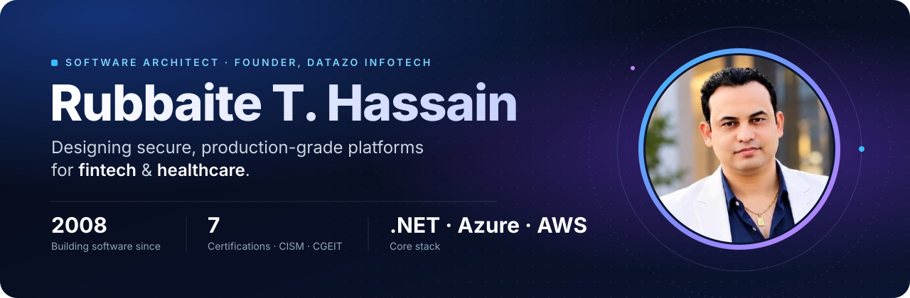

  
  
  
  
  

  I design and review systems where failure is expensive: <b>payments, ledgers, patient data and cloud platforms</b>. 
  Building software since 2008. Founder &amp; Managing Director of <a href="https://www.datazoinfotech.com.bd"><b>Datazo InfoTech</b></a>, with teams in Dhaka and New York.

## How I can help

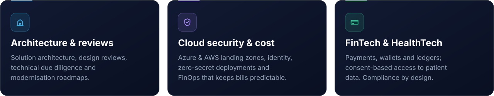

## Flagship platforms

Larger, production-style systems built end to end: architecture, security, tests, CI, container and documentation. Governing what AI agents are allowed to do, a digital twin that keeps an expressway’s traffic model in step with live detector data, and a research platform for cancer mutation data with a tumour-type model that says when it is unsure.

  <a href="https://github.com/md-rubbaite/agentic-ai-governance-platform">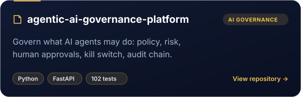</a>
  <a href="https://github.com/md-rubbaite/intelligent-transportation-digital-twin">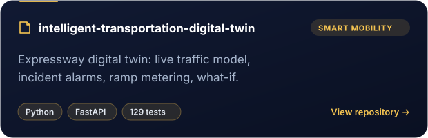</a>
  <a href="https://github.com/md-rubbaite/precision-oncology-ai-platform">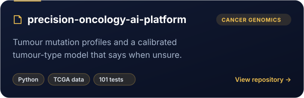</a>

## Solving today's hard problems

Open-source answers to problems engineering teams face right now: securing AI agents, the post-quantum deadline, runaway LLM costs, EU AI Act deadlines, a secure cloud baseline, offline sync, reliable event publishing and legacy .NET migration. Each repo has tests, CI, an ADR and a v1.0.0 release.

  <a href="https://github.com/md-rubbaite/mcp-security-gateway">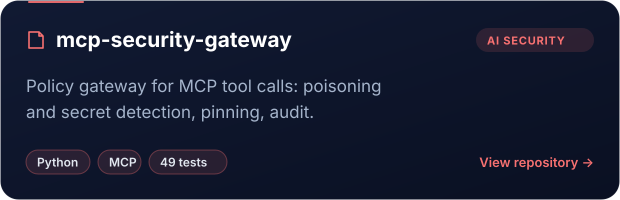</a>
  <a href="https://github.com/md-rubbaite/post-quantum-migration-kit">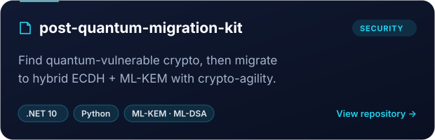</a>

  <a href="https://github.com/md-rubbaite/llm-cost-reliability-guard">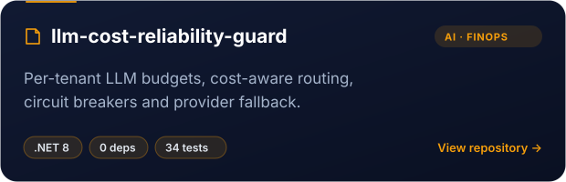</a>
  <a href="https://github.com/md-rubbaite/eu-ai-act-compliance-kit">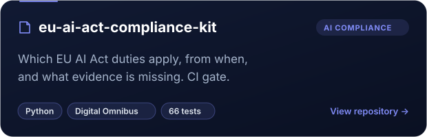</a>

  <a href="https://github.com/md-rubbaite/cloud-native-reference-aws">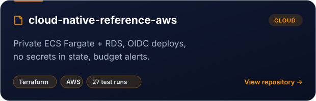</a>
  <a href="https://github.com/md-rubbaite/offline-first-sync-engine">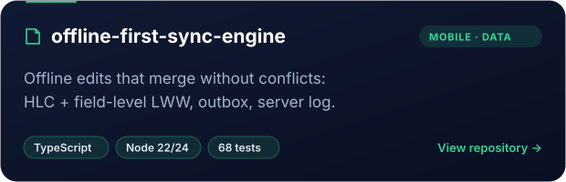</a>

  <a href="https://github.com/md-rubbaite/transactional-outbox-dotnet">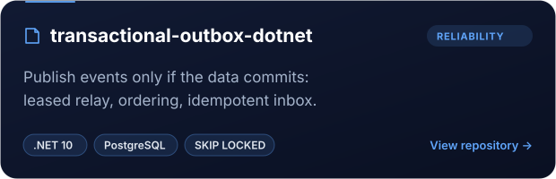</a>
  <a href="https://github.com/md-rubbaite/legacy-dotnet-modernization-kit">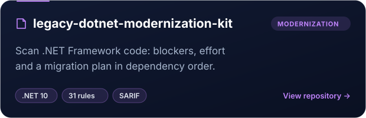</a>

## Featured work

Reference implementations with tests, CI and documented trade-offs.

  <a href="https://github.com/md-rubbaite/payment-idempotency-dotnet">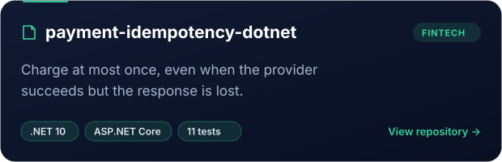</a>
  <a href="https://github.com/md-rubbaite/fintech-ledger-dotnet">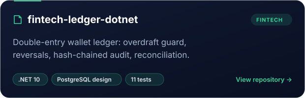</a>

  <a href="https://github.com/md-rubbaite/fhir-consent-gateway-dotnet">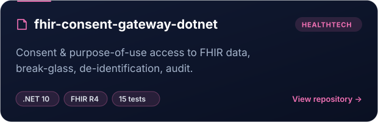</a>
  <a href="https://github.com/md-rubbaite/modular-monolith-dotnet">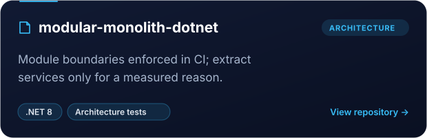</a>

  <a href="https://github.com/md-rubbaite/azure-secure-landing-zone">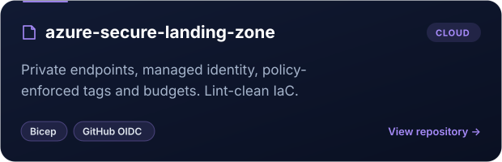</a>
  <a href="https://github.com/md-rubbaite/carbon-credit-registry-solidity">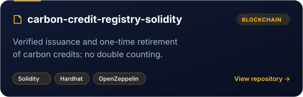</a>

  <a href="https://github.com/md-rubbaite/rag-evaluation-pipeline">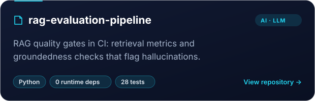</a>
  <a href="https://github.com/md-rubbaite/ai-agent-orchestration-dotnet">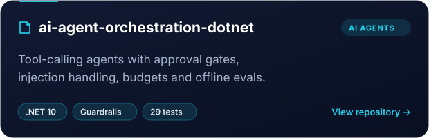</a>

  <a href="https://github.com/md-rubbaite/devsecops-reference-pipelines">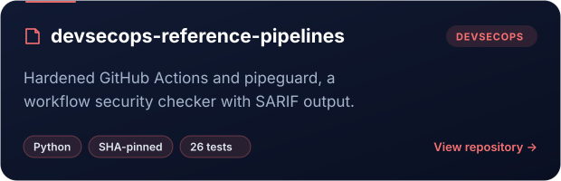</a>
  <a href="https://github.com/md-rubbaite/architecture-review-kit">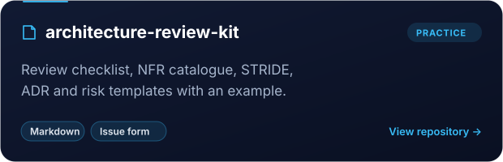</a>

## How I think about architecture

> **Review the failure path, not just the happy path.** What happens when the call succeeds but the response disappears? 
> **Start simple, extract with evidence.** A modular monolith first; microservices when scaling, release cadence or isolation demands it. 
> **Security and cost are design inputs.** Managed identities over secrets, private endpoints over public ones, budgets before bills. 
> **Decide and record.** Every significant choice gets an ADR, with the metric that should reopen it.

## Career since 2008

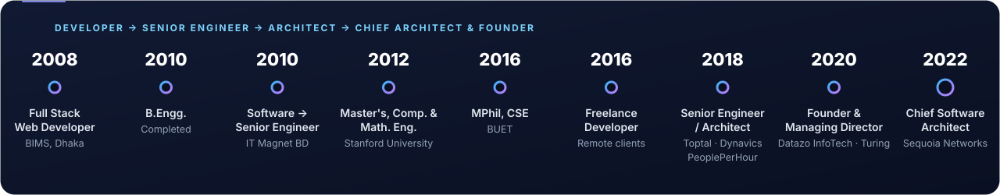

Full career history

| Years | Role | Organisation |
|---|---|---|
| 2008–2010 | Full Stack Web Developer | Bangladesh Institute of Management Studies, Dhaka |
| 2010 | B.Engg. | |
| 2010–2016 | Software Engineer → Senior Software Engineer → Oracle Developer | IT Magnet BD, Dhaka |
| 2012 | M.Engg. | |
| 2012–2013 | Master's degree, Computational & Mathematical Engineering | Stanford University School of Engineering |
| 2016–2018 | Freelance Software Developer | Self-employed, remote clients |
| 2018–2019 | Senior Software Development Engineer (contract) | Dynavics Ltd, UK |
| 2018–2022 | Senior Software Developer (contract) | Toptal |
| 2018–2024 | Solutions Architect (freelance) | PeoplePerHour |
| 2020–2025 | Senior Staff Software Engineer (contract) | Turing |
| 2020–present | Founder & Managing Director | Datazo InfoTech |
| 2022–present | Chief Software Architect (contract) | Sequoia Networks |

## Selected client work

| Project | Domain | Highlights |
|---|---|---|
| Paylinc mobile banking & FX app | FinTech, UK | Biometric login, device-bound keys, separate identity, card and FX services |
| Payment-bureau portal | Payments, Azure | React + Azure AD B2C + Azure-hosted APIs, Azure Monitor |
| TMSS loan management system | Microfinance, Bangladesh | Role-based web app, loan engine, collections, portfolio reporting |
| Open Forest Protocol | Sustainability | Field-data mobile app, analytics web app, blockchain verification |
| SOS Systems asset tracking | Enterprise IT | Smart-contract audit trail, real-time updates, integration API |

More case studies at [datazoinfotech.com.bd/case-studies](https://www.datazoinfotech.com.bd/case-studies/).

## Certifications

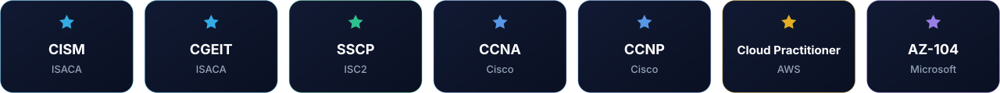

## Tech stack

  
  
  
  
  
  
  
  
  
  
  
  
  

## Writing

I write the **Software Development** newsletter on LinkedIn, covering architecture, cloud cost governance (FinOps) and AI-assisted delivery for engineering leaders. [Read the articles →](https://www.linkedin.com/in/rubbaite/recent-activity/articles/)

## Let's talk

  Planning a platform, reviewing an architecture, or fixing a system that fails in production? 
  <a href="https://tanvir.info.bd"><b>tanvir.info.bd</b></a> · <a href="https://www.datazoinfotech.com.bd"><b>datazoinfotech.com.bd</b></a> · <a href="https://www.linkedin.com/in/rubbaite"><b>LinkedIn</b></a> · <a href="https://www.upwork.com/freelancers/~01ee111f2f8a58debe"><b>Upwork</b></a>

